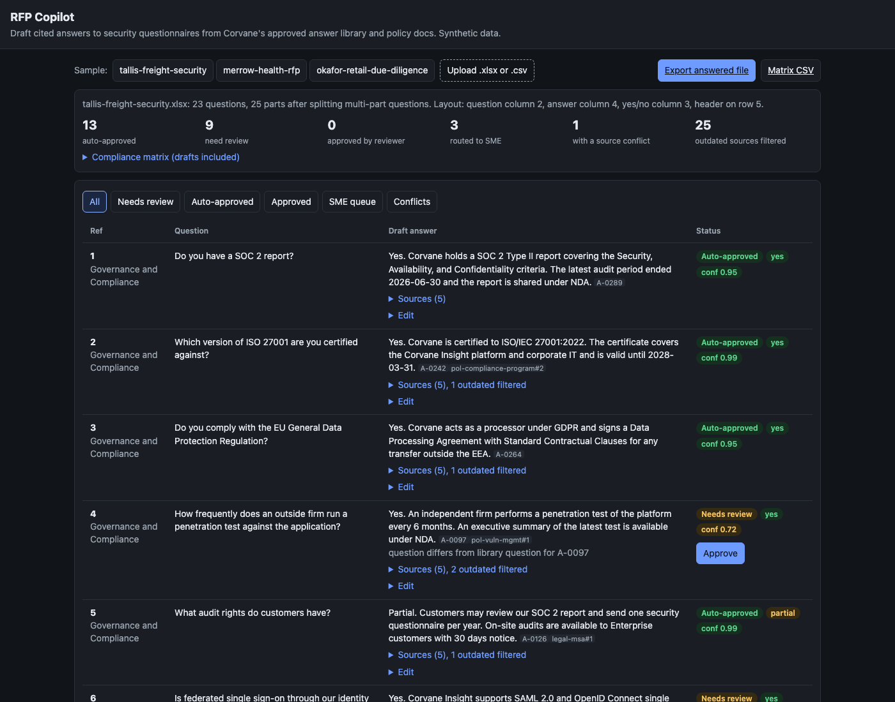

# RFP Copilot

An assistant for answering RFPs and security questionnaires. Upload the customer's spreadsheet (XLSX or CSV, messy as it comes), and it finds the question and answer columns, splits multi-part questions, retrieves candidates from an approved answer library and from policy docs, drops answers that a newer policy has superseded, flags sources that disagree, and drafts an answer that cites its sources. Questions the knowledge base cannot support go to a subject matter expert queue instead of being guessed. A reviewer edits and approves in a web UI, edits are kept as diffs, approved new answers are written back to the library with provenance, and the export fills the customer's original file in place. The vendor is Corvane, a made-up B2B analytics SaaS company, with 60 synthetic policy and product docs and a library of 308 previously approved answers, 26 of them outdated and some contradictory.



**Evaluation** on 80 labeled questions (70 answerable, phrased differently from the library, and 10 the knowledge base cannot answer). `rfpcopilot eval --compare`:

| Metric | BM25 only | BM25 + question similarity + recency rules |
|---|---:|---:|
| Retrieval recall@5 | 98.6% | 98.6% |
| Citation precision | 93.2% | 96.1% |
| Answer accuracy (fact judge) | 87.9% | 94.0% |
| Correct abstention (unanswerable sent to SME) | 80.0% | 100.0% |
| False abstention (answerable sent to SME) | 5.7% | 4.3% |
| **Outdated-source usage** | **9.1%** | **0.0%** |
| Questions with a conflict flag | 0 | 2 |
| Auto-approved share | 0.0% | 3.8% |
| Auto-approved precision | n/a | 100.0% |

BM25 alone finds the right topic almost every time, but it cannot tell a 2023 answer ("pen tests every 12 months") from the current one ("every 6 months"), so it cites a superseded answer on 9.1% of answered questions. The recency rules take that to 0. The eval set uses new wording on purpose, so very little is auto-approved there; auto-approval needs a near-verbatim library question. On the three sample questionnaires, which mix library wording with new wording, the share is much higher:

| Sample questionnaire | Parts | Auto-approved | Needs review | SME queue | Minutes saved at 12 min each |
|---|---:|---:|---:|---:|---:|
| tallis-freight-security.xlsx | 25 | 13 | 9 | 3 | 156 |
| merrow-health-rfp.csv | 27 | 12 | 13 | 2 | 144 |
| okafor-retail-due-diligence.xlsx | 22 | 10 | 9 | 3 | 120 |

CI fails the build if outdated-source usage goes above 2%, correct abstention drops below 80%, or recall@5 drops below 90%.

## Why

Solutions and sales engineering teams spend hundreds of hours a year on security questionnaires and RFPs. Most questions have been answered before, but the answers live in an old spreadsheet, a wiki, and policy PDFs, and some of them are wrong now because a policy changed. The failure that hurts is not a missing answer, it is a confident answer that cites last year's breach notification window or retention period, and ends up in a signed contract. A useful assistant needs four things beyond search: it must prefer current, approved sources, it must say when sources disagree, it must refuse to guess when nothing supports an answer, and every approved answer must make the next questionnaire faster. This repo is a working version of that loop, sized for a laptop.

## Architecture

```
 customer file (.xlsx / .csv)
        |
        v
 parser.py      find header row (title rows above it), roles of columns (question, answer, yes/no, id, section),
                section rows (merged cells), split "a) b)", "(i) (ii)", "...? If so, ...?" into parts
        |
        v
 retrieval.py   library: BM25(question + answer) blended with fuzzy question similarity
                docs:    BM25 over chunks (one chunk per policy heading)
                rules:   drafts rank below approved; an answer older than a disagreeing policy, or more than
                         180 days older than a disagreeing answer, is superseded and dropped; other
                         disagreements become conflict flags
                coverage: IDF-weighted share of the question the top sources talk about
        |
        +-- coverage < 0.35 or an unknown named standard (FedRAMP, CMMC) --> SME queue, routed by topic
        |
        v
 drafting.py    ExtractiveDrafter (default, offline)  |  ClaudeDrafter (claude-opus-5-5, JSON schema output)
                Draft = answer with [source-id] citations, yes/no/partial, citations, confidence, needs_review
                validator: no uncited trailing claims, only known sources, every number must be in a cited source
        |
        v
 pipeline.py    auto_approved: verbatim approved library answer, question similarity >= 0.8, confidence >= 0.85,
                               no conflict.  Otherwise needs_review with the reason.
        |
        v
 review.py      SQLite: jobs, items, edits (unified diffs), library_additions (write-back with provenance)
 export.py      fills the original workbook or CSV in place, plus a compliance matrix by section
 api.py         FastAPI + web UI at /, /healthz, /metrics (Prometheus), JSON logs
 evaluate.py    labeled set, bm25 vs hybrid, fact judge (offline) or Claude judge, CI gate
```

| Piece | File |
|---|---|
| Synthetic facts: 80 topics, current and outdated values, 10 unanswerable questions | `src/rfpcopilot/kbdata.py` |
| Corpus generation, chunking, save and load as markdown + JSON | `src/rfpcopilot/kb.py` |
| Sample questionnaires and the eval set | `src/rfpcopilot/samples.py` |
| Generated files you can open: docs, `answers.json`, questionnaires, eval set | `data/` |

## How to run

```bash
cd rfp-copilot
uv sync --python 3.12
uv run rfpcopilot serve --port 8822      # UI at http://127.0.0.1:8822, click a sample
```

Other commands:

```bash
uv run rfpcopilot answer data/questionnaires/tallis-freight-security.xlsx   # writes ...-answered.xlsx next to it
uv run rfpcopilot eval --compare                                             # the tables above
uv run rfpcopilot eval --gate --max-outdated 0.02 --min-abstention 0.8       # what CI runs
uv run rfpcopilot gen --out data                                             # regenerate data/
make test lint run screenshot
```

To draft with Claude instead of the offline drafter: `uv sync --extra claude`, set `ANTHROPIC_API_KEY`, and run with `RFPCOPILOT_DRAFTER=claude`. Model drafts go through the same citation validator. A rejected draft falls back to the extractive draft and is marked for review, and a model draft is never auto-approved. `rfpcopilot eval --judge claude` swaps the fact judge for an LLM judge with the same interface.

API: `POST /api/questionnaires` (multipart upload), `POST /api/questionnaires/sample/{name}`, `GET /api/questionnaires/{id}`, `POST .../items/{item}/edit`, `POST .../items/{item}/approve`, `GET .../export`, `GET .../matrix?format=csv`, `GET /api/sme-queue`, `GET /api/library/{id}`, `/healthz`, `/metrics`.

Docker and the GitHub Actions workflow are built and run in CI. Docker is not needed locally: `uv run` is enough.

## Tests

84 tests, `uv run pytest -q`, about 25 seconds. They cover:

- parser: header below title rows, merged section rows, category columns, yes/no plus explanation columns, unusual header names, no header at all, lettered, roman, and follow-up multi-part splitting
- retrieval: exact question ranks first, recency rule drops outdated answers, BM25-only keeps them, conflicts between current answers are flagged, answers to different questions never supersede each other, drafts rank below approved answers, unknown named standards
- citation validator: uncited claims, unknown sources, numbers the source does not contain, unanswered with text
- Claude drafter against a fake client: request shape, structured output, fallback on invalid JSON or uncited output, no call without sources, source text escaped
- abstention and SME routing, auto-approval rules, conflict blocking auto-approval
- review: edits stored as diffs, write-back provenance, the next run auto-approves the written-back answer, persistence across restarts
- export: XLSX round trip keeps every non-answer cell, merged ranges, column widths, and other sheets; CSV round trip; multi-part answers combined in one cell; compliance matrix
- eval metrics and the gate, and the API end to end

## Production notes

- Retrieval is lexical with a small domain thesaurus. At real scale add embeddings for paraphrase recall and keep BM25 for exact terms like "SOC 2 Type II"; the recency and conflict rules sit after retrieval and do not change.
- Fact comparison uses regexes for numbers, units, and versioned terms. A production system would extract facts per policy into a structured table owned by the policy owners, so a policy change marks dependent library answers stale the day it ships, not when someone retrieves them.
- Write-back goes into SQLite next to the generated library. A real deployment keeps the library in a database with an approval workflow per answer owner, expiry dates, and an audit trail exported to the GRC system.
- Reviewer identity is a string in the request. Behind SSO, the approver comes from the identity token and approval rights depend on the topic (legal answers need legal).
- Large questionnaires (500+ rows) should be processed as a background job with progress, and Claude drafting should run through the Batches API with prompt caching on the shared system prompt.

## License

MIT. See [LICENSE](LICENSE).
